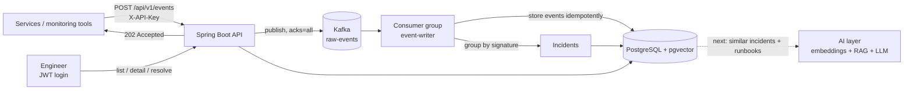

# IncidentIQ

**AI-powered incident and log triage platform** (work in progress).

When a system breaks, hundreds of alerts fire at once and engineers lose time working out which ones belong together. IncidentIQ ingests alerts and logs, groups related alerts into a single incident, and (in progress) retrieves similar past incidents and runbooks to suggest a likely root cause and fix steps, with citations.

> **Status:** the ingestion pipeline, incident grouping and incident APIs are built and tested. The AI layer (embeddings, RAG, LLM suggestions) and the Angular dashboard are in progress. See [Status](#status).

## Architecture



**How it works**

1. A service sends an event with its API key. The API checks the key, publishes the event to Kafka, and answers `202 Accepted`.
2. A consumer group reads the topic and stores each event once. Redelivered messages and retried sends are detected and skipped.
3. For `ERROR` and `CRITICAL` events, the message is normalized (UUIDs, IPs and numbers replaced) and hashed into a signature. Events with the same tenant, service and signature join one open incident.
4. Engineers log in with a JWT, browse incidents and their events, and resolve them with a note. A recurrence after resolution opens a new incident.

## Key design decisions

- **Multi-tenancy:** every row carries a tenant. The tenant always comes from the JWT or the API key, never from the request body.
- **Queue in front of the database:** Kafka absorbs alert bursts. Events are partitioned by `tenantId:service`, so ordering holds per service.
- **At-least-once delivery with idempotent handling:** idempotent producer (`acks=all`), idempotent consumer (event id as primary key, unique index on tenant + service + external id), and a transaction that stores the event and updates the incident together.
- **Race-safe grouping:** a partial unique index allows only one open incident per tenant, service and signature. A concurrent loser retries and joins the winner.
- **API keys:** random keys shown once, stored as SHA-256 hashes, revocable, with `last_used_at` tracking.
- **No lost real events:** the system prefers storing a rare duplicate over dropping a genuine event.

## Tech stack

Java 21, Spring Boot 4, Spring Security (JWT and API-key filter chains), Spring Data JPA, Flyway, PostgreSQL with pgvector, Apache Kafka, Docker Compose, JUnit 5 and Mockito. Planned: Angular dashboard, embeddings and an LLM.

## Getting started

Prerequisites: JDK 21, Maven, Docker.

```bash
# 1. Configure secrets
cp .env.example .env        # then edit the values

# 2. Start Postgres (with pgvector) and Kafka
docker compose up -d

# 3. Create the topic (once)
docker exec incidentiq-kafka /opt/kafka/bin/kafka-topics.sh \
  --bootstrap-server localhost:9092 --create --topic raw-events \
  --partitions 3 --replication-factor 1

# 4. Run the backend (Flyway applies the migrations on startup)
cd backend
set -a; source ../.env; set +a
mvn spring-boot:run
```

Run the tests with `mvn test` from `backend/`. Some context tests need the environment variables and a running database.

## Try it with the simulator

`tools/simulator/Simulator.java` is a single-file Java program that creates demo tenants and API keys, sends realistic traffic, and generates alert storms.

```bash
cd tools/simulator
java Simulator.java setup            # creates tenants, services and API keys
java Simulator.java run 30           # 30 seconds of normal traffic
java Simulator.java storm alpha payment-api 100   # 100 near-identical errors
```

A storm of 100 similar errors ends up as one incident with an event count of 100.

## API overview

| Area | Endpoints | Auth |
|---|---|---|
| Auth | `POST /api/v1/auth/signup`, `POST /api/v1/auth/login` | none |
| Users | `POST /api/v1/users` (admin only), `GET /api/v1/me` | JWT |
| API keys | `/api/v1/api-keys` (create, list, revoke) | JWT, admin |
| Events | `POST /api/v1/events` (ingest) | API key |
| Events | `GET /api/v1/events` (paginated, optional service filter) | JWT |
| Incidents | `GET /api/v1/incidents`, `GET /api/v1/incidents/{id}`, `GET /api/v1/incidents/{id}/events`, `POST /api/v1/incidents/{id}/resolve` | JWT |

## Status

- [x] Multi-tenant auth: signup, JWT login, roles (ADMIN / ENGINEER)
- [x] API keys: hashed, revocable, shown once
- [x] Events API with idempotency, plus paginated listing
- [x] Kafka ingestion: idempotent producer and consumer, `202 Accepted`
- [x] Incident grouping by signature, with race-safe incident creation
- [x] Incident APIs: list, detail, events, resolve
- [x] Simulator for traffic and alert storms
- [ ] AI layer: embeddings, similar-incident search, runbooks, LLM suggestions with citations
- [ ] Helpful / Wrong feedback for evaluation
- [ ] Angular dashboard
- [ ] Integration tests (Testcontainers), CI, Dockerfiles, deployment
- [ ] Rate limiting, observability, load tests

## Notes

The project uses synthetic data only.
